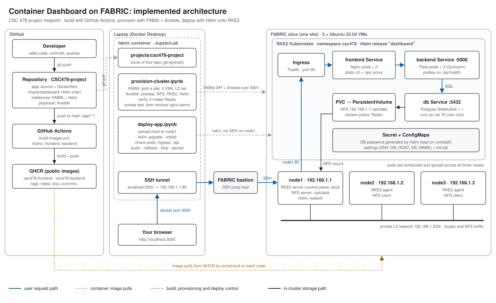

# Container Dashboard on FABRIC

CSC 478 Cloud Engineering · Ethan Charest

This project takes the **Container Dashboard**, a three-tier web app I built in CSC 468 (Nginx frontend, Flask REST API, PostgreSQL database), and moves it from a single Docker host onto a **three-node Kubernetes cluster (RKE2) on the FABRIC testbed**.

In CSC 468 the whole app ran with Docker Compose on one CloudLab VM, so if that machine went down, the app went down. Here, every step is automated, from creating the virtual machines to running the app, and Kubernetes keeps the app running: it spreads copies across machines, replaces failed containers, and scales on demand.

**Status (project midpoint):** the full pipeline works end to end. GitHub Actions builds the images, one notebook builds the cluster, and a second notebook deploys the app with Helm. Remaining work is listed at the bottom.

## Architecture



The system has three stages, each owned by a different tool:

| Stage | Tool | Result |
|---|---|---|
| **Build** | GitHub Actions | Frontend and backend images on GitHub Container Registry (GHCR) |
| **Infrastructure** | FABlib + Ansible (`notebooks/provision-cluster.ipynb`) | 3 Ubuntu VMs on a private network, running RKE2 Kubernetes, with an NFS share and Helm |
| **Application** | Helm (`notebooks/deploy-app.ipynb`) | The Container Dashboard running in namespace `csc478` |

**Request path:** browser → SSH tunnel through the FABRIC bastion → Traefik ingress (port 80) → `frontend` Service → Nginx pods → `/api/` → `backend` Service → Flask pods → `db` Service → PostgreSQL → files on the NFS share on node1.

The architecture planned in Deliverable 1 is in [`docs/architecture-deliverable1.svg`](docs/architecture-deliverable1.svg). What changed and why is described under [Changes since Deliverable 1](#changes-since-deliverable-1).

## Repository layout

```
.
├── .github/workflows/build-images.yml   CI: builds and pushes both images to GHCR
├── app/                                 the application source
│   ├── backend/                         Flask API (Gunicorn) + Dockerfile
│   ├── frontend/                        Nginx config, static UI + Dockerfile
│   ├── db/init.sql                      schema for local runs
│   └── docker-compose.yml               run the app locally without a cluster
├── charts/dashboard/                    Helm chart for the app on Kubernetes
│   ├── values.yaml                      every setting: replicas, image tag, storage, ingress
│   ├── files/init.sql                   schema (Helm can only read files inside the chart)
│   └── templates/                       Deployments, StatefulSet, Services, PV/PVC, Secret, ConfigMaps, Ingress
├── notebooks/
│   ├── provision-cluster.ipynb          builds the FABRIC slice and the RKE2 cluster
│   └── deploy-app.ipynb                 installs the chart, verifies it, runs the experiments
├── playbook/                            Ansible
│   ├── playbook-nfs.yml                 NFS server on node1, clients on node2/node3
│   ├── playbook-helm.yml                installs Helm on node1
│   └── (inventory, prereqs and RKE2 playbooks are generated on every run)
├── docs/                                Deliverable 1 report and architecture diagrams
└── resume/
```

## How to run it

### Prerequisites

- The course's `fabric` environment running in Docker, with a valid FABRIC configuration (bastion key, slice key, project ID).
- This repository cloned into a git-ignored folder inside `fabric`:

  ```bash
  cd fabric
  mkdir projects && echo '*' > projects/.gitignore
  git clone https://github.com/ethancharest/CSC478-project.git projects/csc478-project
  ```

- `projects/` mounted into the container. Add `docker-compose.override.yml` next to the course's `docker-compose.yml`, then restart the container:

  ```yaml
  services:
    fabric:
      volumes:
        - ./projects:/home/fabric/projects
  ```

### 1. Build the cluster: `notebooks/provision-cluster.ipynb`

Run all cells. The notebook:

1. Finds a FABRIC site with enough free cores and RAM. If anything fails at a site, it deletes that slice and tries the next one.
2. Creates 3 VMs (8 cores, 10 GB RAM, 50 GB disk each) on a private L2 network, `192.168.1.0/24`.
3. Generates the Ansible inventory and the prerequisite and RKE2 playbooks from the course templates.
4. Runs four playbooks in order: **prereqs → NFS → RKE2 → Helm**. node1 becomes the RKE2 server and NFS server; node2 and node3 join as agents.
5. Checks that all 3 nodes are `Ready` and that a test nginx app answers on port 30080, then removes the test app.

This takes about 15–30 minutes. Ansible output for each site goes to `notebooks/logs/<site>-ansible.log`.

### 2. Deploy the app: `notebooks/deploy-app.ipynb`

Run sections 1–4. The notebook finds the running slice, uploads `charts/dashboard` to node1, and runs:

```bash
helm upgrade --install dashboard <chart> --namespace csc478 --create-namespace --wait --timeout 10m
```

Then it lists the pods, Services, Ingress and PVC, and calls `/api/data` several times through the ingress. Different pod names come back, which shows the load balancing.

### 3. Open the dashboard

The cluster is only reachable through the FABRIC bastion. Section 5 of `deploy-app.ipynb` prints an SSH tunnel command. Paste it into a Jupyter terminal, leave it running, and open **http://localhost:3000** on your computer. Port 3000 is one of the ports the course container publishes.

### 4. Experiments

Section 6 of `deploy-app.ipynb` demonstrates each goal from the Deliverable 1 report:

| Goal | Command | What you see |
|---|---|---|
| Scaling | `helm upgrade ... --reuse-values --set backend.replicas=5` | Two more backend pods; new pod names on the dashboard |
| Rollback | `helm rollback dashboard` | Release history shows numbered revisions; back to 3 replicas |
| Self-healing | `kubectl delete pod <backend pod>` | Kubernetes immediately starts a replacement |
| Persistence | `kubectl delete pod dashboard-postgres-0` | Log entries are still there after the pod comes back |

### 5. Clean up

- `deploy-app.ipynb`, section 7: `helm uninstall` removes the app. The database Secret and the data on NFS are kept on purpose.
- `provision-cluster.ipynb`, section 8: deletes the slice.

## How it works

### Build: GitHub Actions

`.github/workflows/build-images.yml` runs on every push to `main` that changes `app/`, on version tags (`v*`), or manually from the Actions tab.

- A matrix builds `frontend` and `backend` in parallel for `linux/amd64`.
- It logs in to GHCR with the workflow's temporary `GITHUB_TOKEN`, so no secrets are stored, and the workflow only gets `contents: read` and `packages: write`.
- Each image is tagged `latest` and `sha-<commit>`, plus `<version>` on release tags. Pinning `image.tag` to a `sha-` tag in the chart gives a fully reproducible deployment.
- Layer caching keeps rebuilds fast.

The images are public: `ghcr.io/ethancharest/csc478-frontend` and `ghcr.io/ethancharest/csc478-backend`. The cluster never builds anything; containerd on each node pulls these images.

### Infrastructure: FABlib and Ansible

- **FABlib** creates the slice: three `default_ubuntu_22` VMs, each with a basic NIC on a shared L2 network, with static addresses `192.168.1.1–3`.
- **Ansible** configures the VMs over SSH through the FABRIC bastion:
  - `playbook-prereqs.yml`: packages, swap off, kernel modules, sysctl, hostnames, `/etc/hosts`.
  - `playbook-nfs.yml`: node1 exports `/opt/data` to `192.168.1.0/24`; node2 and node3 mount it.
  - `playbook-rke2.yml`: installs RKE2 with `node-ip` set to the private address. It configures Canal (Flannel/Calico) to pick the private NIC, because FABRIC management interfaces are often IPv6-only and own the default route.
  - `playbook-helm.yml`: installs Helm on node1.

### Application: the Helm chart

`charts/dashboard` creates everything in namespace `csc478`:

| Object | Purpose |
|---|---|
| `frontend` Deployment (2) + Service | Nginx serves the UI and proxies `/api/` to `backend:5000` |
| `backend` Deployment (3) + Service | Flask API under Gunicorn; readiness and liveness probes on `/api/health` |
| `postgres` StatefulSet (1) + `db` Service | PostgreSQL; a StatefulSet guarantees only one database pod at a time |
| PersistentVolume + Claim | Static NFS volume, `192.168.1.1:/opt/data`, reclaim policy `Retain` |
| Secret | Random database password, generated on the first install |
| ConfigMaps | `ENV`, `DB_HOST`, `DB_NAME`, and `init.sql` |
| Ingress | Traefik routes port 80 to the frontend; the only way into the cluster |

Design decisions:

- **Service names stay `frontend`, `backend` and `db`.** These are the hostnames the CSC 468 code already used, so Kubernetes DNS replaces Docker Compose networking with no code changes.
- **The database lives on NFS.** The Postgres pod can be rescheduled to any node and still find its data.
- **Postgres runs as uid 70, not root.** The NFS export squashes root, and Postgres's normal root startup fails on NFS.
- **The password is never in Git.** Helm generates it on the first install, and the Secret is kept on `helm uninstall`, so a reinstall still matches the existing database files.
- **The database has a startup probe.** It allows up to 5 minutes for the first initialization over NFS before liveness checks begin.
- **Topology spread constraints** put frontend and backend replicas on different nodes.
- **The Downward API** passes each backend pod its own pod, node and namespace name, which the dashboard displays. Refreshing the page shows requests being balanced across pods and nodes.

### Application changes from CSC 468

- Flask now runs under Gunicorn and as a non-root user.
- `/api/data` reports the pod, node and namespace.
- The dashboard's "Served By" card refreshes every 3 seconds.
- Fixed a cross-site scripting issue: log entries are inserted as text, not HTML.
- Database connections always close, and invalid POST bodies return 400.

## Local development

To run the app without a cluster:

```bash
cd app
docker compose up --build
```

Then open http://localhost. This uses the same Dockerfiles that GitHub Actions builds from.

## Changes since Deliverable 1

| Deliverable 1 plan | What was built | Why |
|---|---|---|
| A FABlib notebook for the VMs, then an Ansible notebook that installs RKE2 **and** deploys the app | One notebook builds the whole cluster (FABlib + Ansible); a second deploys the app | Separates infrastructure from application, so the app can be redeployed without rebuilding the cluster |
| Plain Kubernetes files applied with `kubectl` | A **Helm chart** | One versioned release: install, upgrade, roll back and uninstall with one command, with settings in one `values.yaml` |
| Simple local storage that ties the database to one node | **NFS** share from node1 | The database pod can move between nodes and keep its data |
| Push images to GHCR | Automated with **GitHub Actions** | Every change to `app/` produces versioned images without manual steps |
| Expected to configure NAT64 for IPv6-only sites | Not needed so far | The nodes reached GitHub and GHCR at the sites used |
| Pin the RKE2 version | Not done yet | The course playbook installs the current stable release; see remaining work |
| Users reach the app through the ingress | Ingress plus an **SSH tunnel** through the FABRIC bastion | The VMs have no public addresses, so the bastion is the only way in |

## Known limitations and remaining work

- **node1 is a single point of failure.** It is both the Kubernetes control plane and the NFS server.
- **One database replica.** Two Postgres processes can't share a data directory; real replication would need a Postgres operator.
- **Combine the two notebooks** into one `notebooks/deploy.ipynb` that always rebuilds the cluster, deploys the app, and starts the tunnel automatically.
- **Pin the RKE2 version** and pin `image.tag` to a `sha-` tag so every rebuild is identical.
- **Show node failure:** drain a node and verify that the app keeps serving.

## Documents

- [Deliverable 1 technical report (PDF, includes resume)](docs/Deliverable1.pdf)
- [Deliverable 1 architecture diagram](docs/architecture-deliverable1.svg)
- [Resume](resume/resume.pdf)
